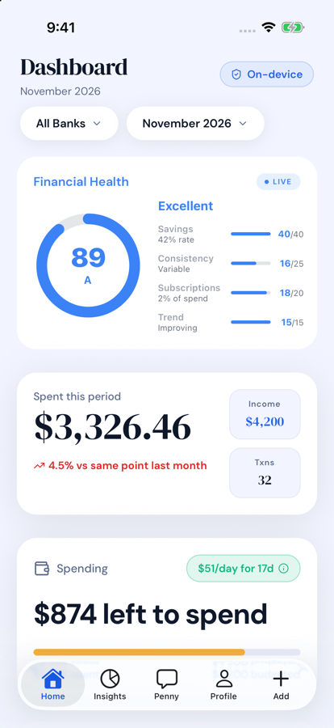
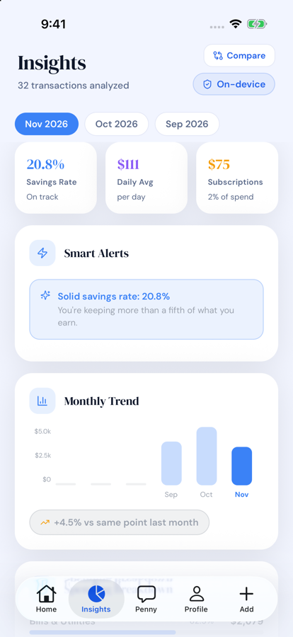
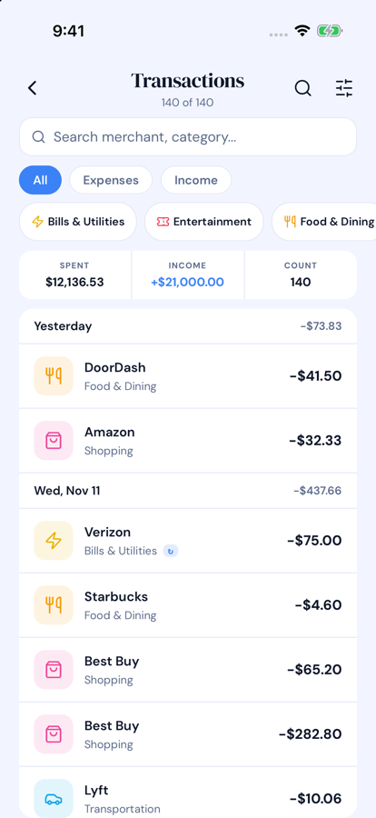
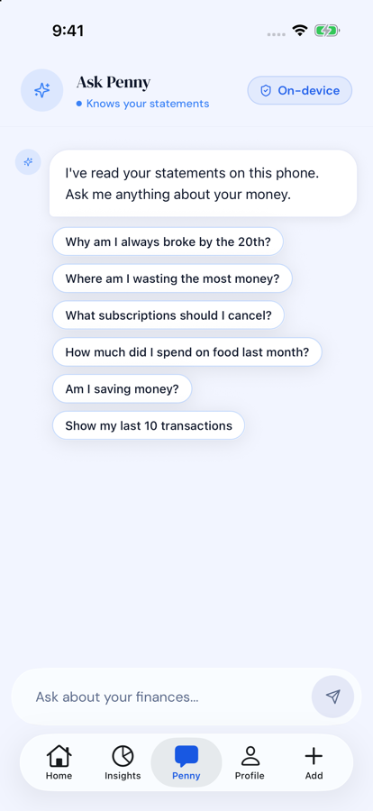
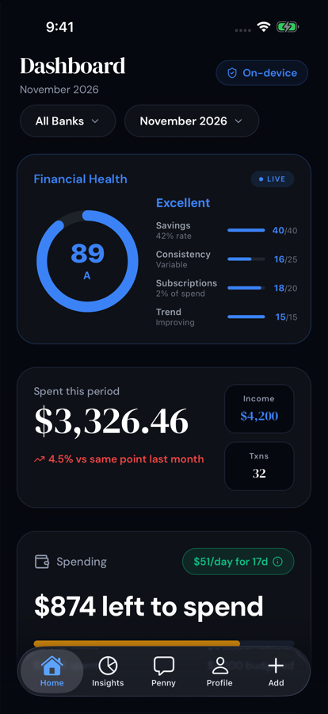

# ClearMoney

A personal finance app for iPhone where nothing leaves the device. A fine-tuned Gemma 4 model sorts your bank transactions and answers questions about them, running on the phone itself. There is no server, no account and no analytics.

<p align="center">
  
  
  
  
  
</p>

<p align="center"><sub>Sample data. <a href="https://www.youtube.com/watch?v=FaZXaY6Ym6Q">Demo video</a> (recorded on an earlier version).</sub></p>

## Results

Transaction categorisation, measured on 198 labelled statement lines with the same rules, prompts and parser the app ships ([method and limits](eval/README.md), [full results](eval/RESULTS.md)):

| System | Answered | Accuracy | National brands | Small merchants |
|---|---|---|---|---|
| Rules only | 52% | 52% | 94% | 12% |
| Fine-tuned model only | 100% | 82% | 80% | 84% |
| **Shipped pipeline (rules, then model)** | 100% | **91%** | 99% | 84% |

The rules are right 99% of the time when they match, but they match only half the lines. The model covers the rest. Neither reaches the combined score alone.

## How it works

1. **Import.** A statement PDF or a photo is turned into text on the phone (pdf.js or Tesseract in a hidden WebView).
2. **Parse.** Bank-specific parsers for Chase, Bank of America, Wells Fargo and Citi extract the transactions.
3. **Categorise.** Over a hundred merchant rules run first. Whatever they don't recognise goes to the model in batches of five, and the model's answer is validated against a fixed category list.
4. **Store.** Everything is written to SQLite in the app's sandbox.
5. **Ask.** Questions with one right answer ("how much did I spend at Starbucks?") are computed in code, so they are exact. Advice questions go to the model, grounded in figures computed from your data, and each answer says which of the two produced it.

## Engineering worth a look

- **The evaluation runs the app's own code.** Prompt building, output parsing and the batch loop live in modules with no React Native imports ([`categorizerCore.ts`](src/gemma/categorizerCore.ts), [`promptFormat.ts`](src/gemma/promptFormat.ts)), so [`eval/run.ts`](eval/run.ts) cannot drift from what ships.
- **Decisions made by measurement.** The model's published chat template and the app's prompts use different turn markers. Both were evaluated; they scored within one row of each other, so the format stayed.
- **One completion at a time.** The inference runtime allows a single completion per context, so every caller goes through one promise queue ([`client.ts`](src/gemma/client.ts)).
- **A small design system.** Tokens, one icon and colour per category, one money format, and shared header and badge components ([`src/design`](src/design)).
- **139 unit tests** and CI (typecheck, lint, tests) on every pull request.

## Bugs found by testing with real statements

| What the app showed | What was true | Fix |
|---|---|---|
| "Great job! Spending down 34%" | Spending was up 4.5%: twelve days were being compared with a full month | [#4](https://github.com/sanjay347/Gemma-4-hackathon/pull/4) |
| A +$548.81 deposit | A $10.00 purchase: the running balance was read as the amount | [#7](https://github.com/sanjay347/Gemma-4-hackathon/pull/7) |
| "Duplicate charge!" on every subscription | No duplicates: all-time charges were counted instead of this month's | [#4](https://github.com/sanjay347/Gemma-4-hackathon/pull/4) |
| 75% of spending in "Other" | Card-purchase boilerplate hid the merchant from the rules and the model | [#7](https://github.com/sanjay347/Gemma-4-hackathon/pull/7) |
| "Load failed" when importing a PDF | The PDF engine was loaded in a way current iOS rejects | [#7](https://github.com/sanjay347/Gemma-4-hackathon/pull/7) |

## Limits

- The test set is 198 hand-written lines, not a sample of real statements, and there is no comparison with the base model yet, so the results do not show how much the fine-tuning helped.
- The model is a 5.3 GB download and needs a recent iPhone.
- Four US banks are supported. Other layouts will not parse.
- The PDF and OCR engines are downloaded on first use, then cached; they are not yet bundled in the app.
- The project is on Expo SDK 54, which needs the build steps below on Xcode 27.

Originally built for the [Gemma 4 Good Hackathon](https://kaggle.com/competitions/gemma-4-good-hackathon). The sections below go into detail.

---

## AI Stack

### Fine-tuning with Unsloth
We fine-tuned **Gemma 4** on real-world financial transaction data using [Unsloth](https://github.com/unslothai/unsloth) — cutting training time in half and reducing GPU memory by 60% vs standard fine-tuning. The model learns to categorise transactions, detect recurring charges, and understand merchant names across all supported banks.

→ Weights published on [Hugging Face](https://huggingface.co/sanjay3478/clearmoney-categorizer)

### GGUF Quantisation & llama.cpp Inference
The fine-tuned model is quantised to **GGUF format** — the compressed binary standard used by llama.cpp. The 5.3 GB file is downloaded once on first launch and runs **real-time inference on an iPhone** with zero internet.

### Cactus-Style Intelligent Routing
A two-stage pipeline inspired by [Cactus](https://github.com/cactus-compute/cactus):
- `tryRuleCategorize` — rule engine for well-known merchants (no inference)
- `batchCategorize` — the fine-tuned model handles everything the rules don't recognise, five descriptions per call

The model only runs on the transactions that need it, which saves time and battery. Model output is validated against the fixed category list before it is stored.

### Statement Parsing
| Input | Engine |
|-------|--------|
| Digital PDF | PDF.js (sandboxed WebView) |
| Paper photo | Tesseract.js OCR (sandboxed WebView) |

Text extraction runs on the device and statement contents are never uploaded. The PDF.js and Tesseract.js libraries are downloaded from a public CDN the first time each is used, then cached; Tesseract also fetches its OCR engine and English language data. Bundling these into the app is planned.

---

## Features

### Dashboard
- **Financial Health Score** — live ring (0–100), calculated from SQLite, "LIVE" badge
- **Spent This Period** — animated number, month-over-month trend arrow, Income + Txn count mini-stats
- **Spending Card** — remaining budget, daily rate pill ($/day for N days), progress bar (blue → amber → red)
- **Quick Actions** — Search, Transactions, Subscriptions, Budgets, Calendar, Ask AI
- **Bill Predictor** — forecasts upcoming recurring charges
- **Spending Trend** — 6-month bar chart
- **Category Breakdown** — segmented colour bar + Donut chart
- **Budgets** — live progress bars for each category
- **Overview Table** — Total Income, Total Spent, Net, Transaction count
- Filter by **bank** and **month** — all computed from local SQLite

### Insights
- **Snapshot strip** — Savings Rate, Daily Average, Subscription total (3 stat cards)
- **Smart Alerts** — auto-fires for spending spikes, low savings rate, subscription bloat, weekend anomalies
- **Monthly Trend** — 6-month bar chart with month-over-month percentage badge
- **Spending Breakdown** — per-category percentage bars, ranked by amount
- **Habits & Patterns** — weekday avg, weekend avg, busiest day of week, biggest single transaction
- **Recurring Charges** — auto-detected subscription list
- **Income vs Spending** — net savings bar, green/red result
- **Month picker** — tap any month chip to recompute everything instantly

### AI Chat
- Conversational interface with your custom-named AI advisor
- **Lookups are computed, not generated.** "How much did I spend at Starbucks?" has one right answer, so it is calculated from SQLite in code and is always exact.
- **Advice comes from the model.** "Should I cancel Netflix?" goes to the fine-tuned Gemma 4, streamed token by token, grounded in a summary computed from your transactions so the figures it quotes are real.
- Falls back to the computed answer if the model is unavailable
- Transaction lists ("show my last 10 transactions") are shown as rows, not text
- Every answer is labelled as calculated from your transactions or written by the model
- Starter question chips + contextual follow-up suggestions after every answer
- Dollar amounts highlighted inline in responses
- **100% on-device** — nothing about your question or your data leaves the phone

### Compare Mode
Side-by-side comparison of any two months. Per-category delta badges — green where spending improved, red where it increased.

### Budgets
- Create budgets per spending category
- Haptic warning at 90% threshold (Heavy impact via expo-haptics)
- Budget rollover support

### Other Screens
- **Transactions** — searchable, filterable full history with per-row haptic feedback
- **Subscriptions** — auto-detected recurring charges list
- **Calendar** — transaction calendar view
- **Search** — full-text search across all transactions

### Privacy & Security
- **Face ID / Touch ID** lock via `expo-local-authentication`, re-locks after 60s in background
- **All data in expo-sqlite** on-device — no sync, no backup to cloud
- **No account, no login, no tracking, no analytics**
- Profile page: *"All data stays on your device. Zero cloud. Zero tracking."*
- Factory Reset permanently deletes all data + model file

### Design System
- `src/design/tokens.ts` — spacing, radius and type scales
- `src/design/categories.ts` — one icon and one colour per spending category
- `src/design/format.ts` — one set of rules for writing money, dates and merchant names
- Shared `ScreenHeader`, `CategoryIcon` and `PrivacyBadge` components
- System tab bar via Expo Router native tabs: Liquid Glass on iOS 26+, and taps that respond while a screen is loading
- Follows the phone's light or dark setting, with a crossfade when switched in Profile

### Onboarding
- Says what the one-time model download is and how big (5.3 GB) before starting it, and warns on mobile data
- Shows download progress in gigabytes and percent, and offers a retry if it fails

### UX Polish
- Dark / light theme toggle
- `expo-haptics` throughout: taps, budget creation, warnings, upload success
- Skeleton loading screens (animated opacity pulse matching content layout)
- Pull-to-refresh on Dashboard and Insights
- Offline indicator badge ("on device") in headers

---

## Tech Stack

| Layer | Technology |
|-------|-----------|
| Framework | React Native · Expo SDK 54 · Expo Router v3 |
| Architecture | New Architecture (RCTNewArchEnabled: true) |
| AI Model | Gemma 4 (fine-tuned) |
| Fine-tuning | Unsloth |
| Model format | GGUF (5.3 GB, 4-bit quantised) |
| Inference | llama.cpp-compatible on-device runtime |
| Model hosting | Hugging Face |
| Routing | Cactus-inspired rules-then-model pipeline |
| PDF parsing | PDF.js (WebView sandbox) |
| OCR | Tesseract.js (WebView sandbox) |
| Database | expo-sqlite |
| Biometrics | expo-local-authentication |
| Haptics | expo-haptics |
| Typography | DM Sans + DM Serif Display |
| Charts | react-native-svg (custom DonutChart, SpendingBarChart) |

### Supported Banks
- Chase
- Bank of America
- Wells Fargo
- Citi

---

## Project Structure

```
ClearMoney/
├── app/
│   ├── (tabs)/
│   │   ├── dashboard.tsx       # Main dashboard
│   │   ├── insights.tsx        # Analytics & insights
│   │   ├── chat.tsx            # AI chat interface
│   │   ├── profile.tsx         # Settings & profile
│   │   └── _layout.tsx         # Tab bar layout
│   ├── upload.tsx              # Statement import & processing
│   ├── compare.tsx             # Month comparison
│   ├── budgets.tsx             # Budget management
│   ├── transactions.tsx        # Transaction list
│   ├── subscriptions.tsx       # Recurring charges
│   ├── calendar.tsx            # Calendar view
│   ├── search.tsx              # Full-text search
│   ├── onboarding.tsx          # First-run setup
│   └── index.tsx               # Entry / model download
├── src/
│   ├── components/
│   │   ├── HealthScoreRing.tsx  # Financial health ring
│   │   ├── DonutChart.tsx       # Category donut
│   │   ├── SpendingBarChart.tsx # Monthly trend bars
│   │   ├── BillPredictor.tsx    # Upcoming bills
│   │   ├── AnimatedNumber.tsx   # Counting number animation
│   │   ├── BiometricLock.tsx    # Face ID / Touch ID gate
│   │   ├── Skeleton.tsx         # Loading skeletons
│   │   ├── ProcessingView.tsx   # Upload pipeline UI
│   │   ├── ThemeContext.tsx      # Dark/light theme
│   │   ├── InsightCard.tsx      # AI insight cards
│   │   ├── OfflineIndicator.tsx # "on device" badge
│   │   └── Typography.ts        # Font tokens
│   ├── gemma/
│   │   ├── client.ts            # llama.cpp inference client
│   │   ├── batchCategorizer.ts  # Gemma 4 batch categorisation
│   │   ├── rules.ts             # Rule-based fast categoriser
│   │   ├── downloadManager.ts   # Model download & progress
│   │   ├── prompts.ts           # Prompt templates
│   │   ├── transferDetector.ts  # Transfer vs expense detection
│   │   └── agents/
│   │       ├── chat.ts          # Conversational AI agent
│   │       ├── categorizer.ts   # Transaction categoriser agent
│   │       ├── predictor.ts     # Cash flow predictor agent
│   │       └── behavior.ts      # AI personality & behaviour
│   ├── parsers/
│   │   ├── chase.ts             # Chase PDF parser
│   │   ├── bofa.ts              # Bank of America parser
│   │   ├── wellsfargo.ts        # Wells Fargo parser
│   │   ├── citi.ts              # Citi parser
│   │   ├── pdfExtractor.tsx     # PDF.js WebView extractor
│   │   ├── imageOCR.tsx         # Tesseract.js WebView OCR
│   │   ├── shared.ts            # Shared parsing utilities
│   │   └── index.ts             # Parser router
│   ├── db/
│   │   ├── schema.ts            # SQLite schema & migrations
│   │   └── transactions.ts      # All DB queries
│   └── types/
│       └── index.ts             # TypeScript types
```

---

## Getting Started

### Prerequisites
- Node.js 18+
- Expo CLI
- Xcode (for iOS simulator or device)
- An iOS device or simulator

### Install

```bash
git clone https://github.com/sanjay347/Gemma-4-hackathon.git
cd Gemma-4-hackathon
npm install
```

### Run

```bash
npx expo run:ios
```

On Xcode 27, `expo run:ios` stops with "Can't determine id of Simulator app" (Expo SDK 54 predates the tool that replaced the Simulator app). Build with Xcode's own tools instead:

```bash
xcodebuild -workspace ios/ClearMoney.xcworkspace -scheme ClearMoney -configuration Release \
  -destination 'generic/platform=iOS' -derivedDataPath ios/build/device-release -allowProvisioningUpdates build
xcrun devicectl device install app --device <your-device-id> \
  ios/build/device-release/Build/Products/Release-iphoneos/ClearMoney.app
```

A Release build bundles the JavaScript, so the phone does not need the Mac afterwards.

On first launch the app will download the fine-tuned Gemma 4 GGUF model (~5.3 GB). This is a one-time download. After that the app works fully offline.

### Develop

```bash
npm run typecheck   # TypeScript, strict mode
npm run lint        # ESLint (eslint-config-expo)
npm test            # Jest unit tests
```

All three run in CI on every push and pull request. The tests cover the bank parsers, the merchant rule engine, transfer detection, model-output validation and chat routing; none of them need a device or the model file.

### Import a Statement

1. Tap **+** to go to the Upload screen
2. Select your bank
3. Choose a PDF or take a photo of a paper statement
4. Watch the on-device pipeline categorise every transaction

---

## Privacy Guarantee

| What we collect | Amount |
|----------------|--------|
| Data sent to servers | **Zero** |
| Analytics or tracking | **None** |
| Account required | **No** |
| Internet after setup | **Not needed** |

All transaction data lives in a local SQLite database on your device. The AI model runs inference locally. Once the model and the parsing libraries have been downloaded, the app works in airplane mode.

---

## Hackathon Tracks

This project is submitted to the following tracks:

| Track | Relevance |
|-------|-----------|
| **Main Track** | Full-stack on-device AI finance app |
| **Digital Equity & Inclusivity** | Free, no account, no subscription, works for anyone |
| **Safety & Trust** | Zero data collection, explainable categorisation, on-device only |
| **Global Resilience** | Fully offline-first, works in low-connectivity regions |
| **Cactus Special Tech** | Rules-then-model routing pipeline |
| **Unsloth Special Tech** | Fine-tuned Gemma 4 on financial transactions with Unsloth |
| **llama.cpp Special Tech** | 4-bit GGUF model running on mobile hardware |

---

## License

MIT — free to use, modify, and build on.

---

<p align="center">
  <strong>ClearMoney v1.0.0 · Built for privacy · Powered by on-device AI</strong>
</p>
